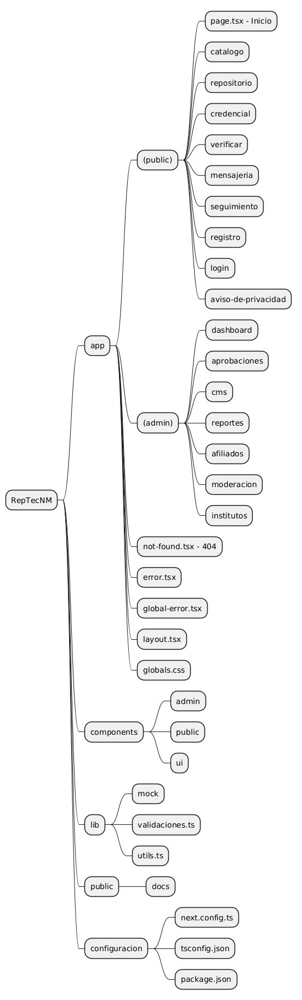

# REP TecNM · Red de Egresados de Posgrado

Plataforma web para la Asociación de Egresados de Posgrado del Tecnológico Nacional de México. Prototipo de alta fidelidad validado con directivos.

## Objetivo

Conectar el talento de posgrado del TecNM mediante una comunidad nacional de profesionales que colabora, investiga y transforma al país.

## Stack tecnológico

- Next.js 16 (App Router, Turbopack)
- TypeScript y React 19
- Tailwind CSS 4 y shadcn/ui
- Recharts, qrcode.react, lucide-react, sonner
- pnpm como gestor de paquetes

## Requisitos previos

- Node.js 20 o superior
- pnpm 9 o superior

~~~bash
npm install -g pnpm
~~~

## Instalación

~~~bash
git clone https://github.com/Alberth812/RepTecNM.git
cd RepTecNM
pnpm install
~~~

## Ejecución en desarrollo

~~~bash
pnpm dev
~~~

Direcciones disponibles al arrancar:

| Entorno | Dirección |
|---------|-----------|
| Local | http://localhost:3000 |
| Red local | http://TU_IP:3000 (la muestra la terminal) |

La dirección de red permite probar en teléfonos y escanear el QR de la credencial durante demostraciones.

## Estructura del proyecto

El diagrama se genera desde `docs/estructura.puml` (PlantUML). Para regenerarlo:

~~~bash
curl -X POST https://kroki.io/plantuml/png \
 -H "Content-Type: text/plain" \
 --data-binary @docs/estructura.puml \
 -o docs/estructura.png
~~~

## Rutas principales

### Lado público

| Ruta | Descripción |
|------|-------------|
| `/` | Inicio con slider editable (incluye avisos importantes), estadísticas agregadas y secciones |
| `/catalogo` | Búsqueda con relevancia (pesos 5-4-2-1) y filtros combinables |
| `/catalogo/[id]` | Ficha completa del profesional |
| `/repositorio` | Publicaciones con visor en línea, foro por documento y contacto al autor |
| `/credencial` | Espacio personal con credencial digital editable e impresión en PDF |
| `/verificar/[folio]` | Verificación pública por código QR con enlace al perfil público |
| `/mensajeria` | Mensajería interna con adjuntos, no leídos y bloqueo |
| `/seguimiento` | Cuestionario de seguimiento en 7 secciones con autoguardado |
| `/registro` | Registro multi-paso con verificación de correo y política de contraseña |
| `/login` | Inicio de sesión con recuperación de contraseña |
| `/aviso-de-privacidad` | Aviso de privacidad y tratamiento de datos |

### Panel de administración

| Ruta | Descripción |
|------|-------------|
| `/dashboard` | Estadísticas operativas con gráficas |
| `/aprobaciones` | Bandeja de aprobación con versionado de solicitudes y observaciones |
| `/cms` | Editor de la página de inicio (slides normales o avisos importantes) |
| `/reportes` | Gestión de reportes de documentos |
| `/afiliados` | Administración de membresías: estados, transiciones y bajas |
| `/moderacion` | Moderación del foro del repositorio |
| `/institutos` | Alta y habilitación de institutos TecNM |

### Manejo de errores

| Archivo | Función |
|---------|---------|
| `app/not-found.tsx` | 404 con mensajes aleatorios de humor y salidas útiles |
| `app/error.tsx` | Falla en cualquier página con reintento |
| `app/global-error.tsx` | Última línea de defensa ante caída total del servicio |

## Requisitos funcionales cubiertos

- RF-AUTH: autenticación, verificación de correo y recuperación de contraseña
- RF-PERFIL: perfil profesional multi-sección con autoguardado
- RF-MEMB: membresía y estados (ACTIVO, INACTIVO, BAJA, PENDIENTE_APROBACION)
- RF-CAT: catálogo de profesionales
- RF-CRED: credencial digital con QR, verificación pública e impresión en PDF
- RF-DOC: repositorio con visor en línea, foro, reportes y moderación
- RF-MSG: mensajería interna
- RF-SEG: cuestionario de seguimiento con indicador al día/desactualizado
- RF-DASH: dashboard y estadísticas públicas agregadas
- RF-ADMIN: administración, aprobaciones, CMS, reportes, afiliados e institutos
- RF-NOTIF: notificaciones en el panel de administración

## Validaciones centralizadas

`lib/validaciones.ts` es la fuente única de verdad de las reglas de negocio del front: política de contraseña, rangos de año y edad, tamaños y tipos de archivo, longitudes de texto y pesos de búsqueda. El backend del Incremento 1 debe espejar estas mismas reglas.

## Scripts disponibles

~~~bash
pnpm dev # servidor de desarrollo en http://localhost:3000
pnpm build # build de producción
pnpm start # servidor de producción
pnpm lint # ESLint
~~~

## Colaboración

Protocolo de trabajo del equipo:

~~~bash
git pull --rebase origin main # antes de empezar y antes de cada push
git add .
git commit -m "tipo: descripcion clara" # tipos: feat, fix, docs, qa
git push
~~~

División sugerida por módulos (no por capas) para evitar conflictos en los mismos archivos.

## Equipo

- Desarrollo: Andres
- Desarrollo:
- Validación: directivos de la Asociación de Egresados de Posgrado del TecNM

---

Última actualización: 2026-08-21
